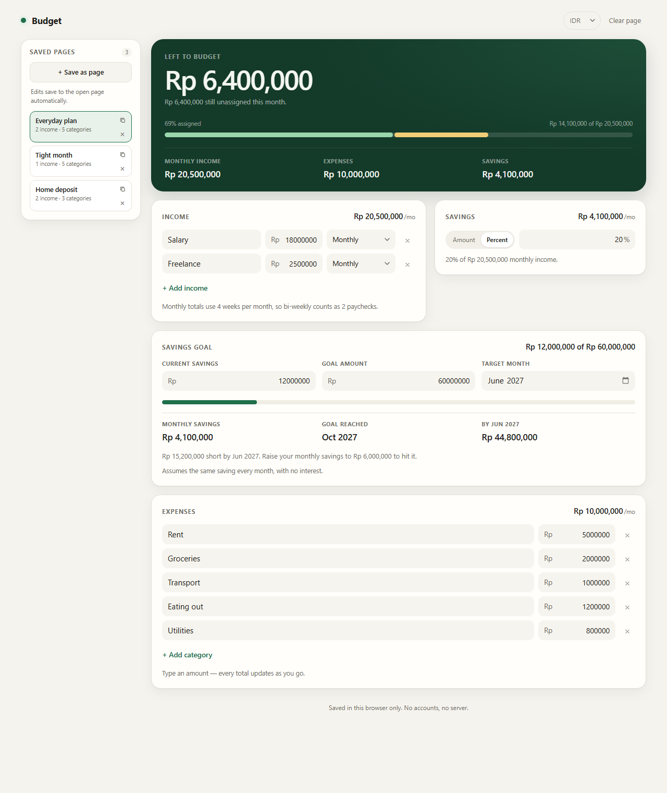

# Budget



A small, private monthly budget planner with saved pages. No accounts, no server — data is saved in your browser.

## What it does

- Add any number of income sources and pick **weekly**, **bi-weekly**, **monthly**, **quarterly**, or **yearly** for each. Everything is converted to a monthly total using 4 weeks per month (weekly ×4, bi-weekly ×2).
- Set savings as a fixed monthly amount or a percentage of income.
- Set a savings goal with your current balance, target amount, and target month.
- See your projected balance by that month, when you'd reach the goal at your current monthly saving, and the monthly amount needed if you'd fall short. Projections assume the same saving every month and no interest.
- Add expense categories and give each one a monthly budget using a number field.
- Live totals: monthly income, expenses, savings, amount left to budget, percent assigned, and an over-budget warning.
- Save the current inputs as a page in the sidebar. Open a saved page to keep editing it — changes save to that page automatically. Duplicate a page to try different numbers without touching the original, or delete pages you no longer need.
- Change currency, including IDR. **Clear page** clears the editor without deleting saved pages; your currency choice is kept when clearing.
- Everything persists automatically in `localStorage`.

## Run it

Open `index.html` in a browser. That's it.

Or serve it from the project root:

```powershell
powershell -ExecutionPolicy Bypass -File .\serve.ps1
```

Then go to <http://localhost:8080/budget/index.html>.

## Files

- `index.html` — structure
- `styles.css` — theme and responsive layout
- `app.js` — state, calculations, rendering, local storage
