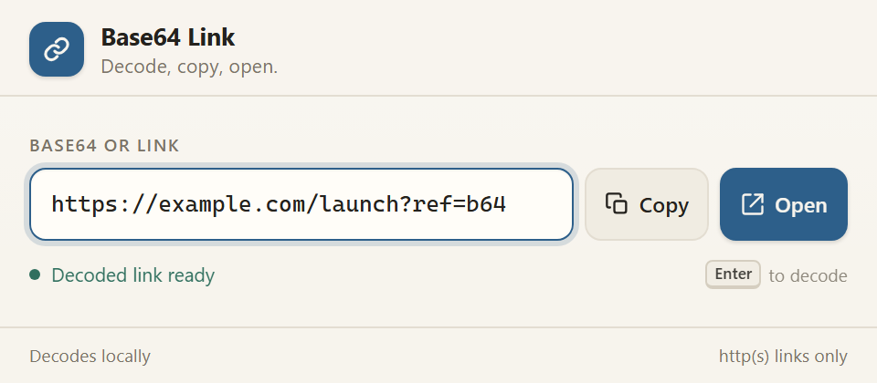

# Base64 Link

Paste Base64, get a link. **Base64 Link** replaces the encoded text in the same field with the decoded URL, then lets you copy it or open it in a new tab.

## Install (unpacked)

1. Open `chrome://extensions` in Chrome or `edge://extensions` in Edge.
2. Turn on **Developer mode**.
3. Click **Load unpacked**.
4. Select this `base64-link-extension` folder — the folder that contains `manifest.json`.
5. Pin **Base64 Link** to the toolbar.
6. Click the icon to open the decoder.

## Use it

1. Paste a Base64-encoded URL into the field. It decodes immediately, in place.
2. Or type or paste Base64 and press **Enter**.
3. Click **Copy** to copy the field contents.
4. Click **Open** to open the decoded link in a new tab.

A URL pasted directly is treated as already decoded, so you can use the same Copy and Open buttons for a normal link.

### What it understands

- Standard Base64 (`+` and `/`)
- URL-safe Base64 (`-` and `_`)
- Missing padding (`=`)
- Spaces, tabs, and line breaks inside the encoded text
- UTF-8 text, including non-ASCII URLs: `https://example.com/café`

### When a value is not a link

- If the Base64 decodes to ordinary text, the field shows the text and a warning. **Copy** still works; **Open** is disabled.
- If the Base64 is invalid, the original text stays in the field with an error so you can fix it.
- **Open** only accepts `http://` and `https://` links. Schemes such as `javascript:`, `data:`, `file:`, and `chrome:` are rejected.

## Data and privacy

- The extension requests only the `clipboardWrite` permission.
- No storage, history, analytics, or background network requests.
- Decoding happens locally in the popup.
- Opening a link is ordinary browser navigation to that site, just like clicking any link.
- The field starts empty each time the popup opens. Nothing is saved.

## Files

| File | Purpose |
| --- | --- |
| `manifest.json` | MV3 manifest, clipboard permission, toolbar popup |
| `popup.html` | Popup layout and controls |
| `popup.css` | Light/dark styling and the 480 × 210 layout |
| `popup.js` | Paste/Enter handling, Base64 decoding, validation, Copy, Open |
| `icons/` | 16/32/48/128 toolbar icons plus a 512 px store icon |
| `preview.png` | Visual preview with a decoded sample link |

## Notes

- No build step and no dependencies. Load the folder directly.
- Verified as an unpacked MV3 extension in Edge (Chromium), with 41 end-to-end checks covering paste, Enter, URL-safe input, missing padding, whitespace, UTF-8, invalid input, non-link text, Copy, Open, and unsafe schemes.
- The same folder installs in Chrome via **Load unpacked**.
- Opening a link uses a normal new browser tab; the popup closes afterward.
