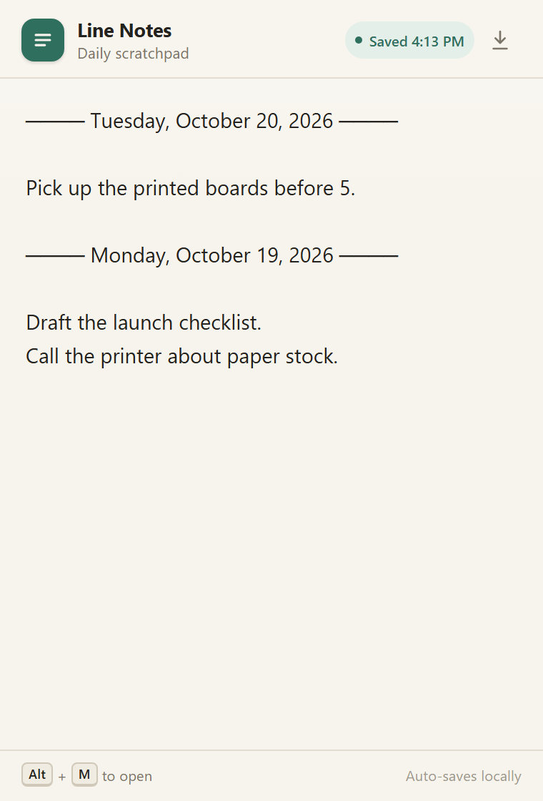

# Line Notes

A tiny daily scratchpad for Chrome. Press **Alt+M** to open it, type, and close. Everything saves locally.



## Install (unpacked)

1. Open `chrome://extensions`.
2. Turn on **Developer mode** (top right).
3. Click **Load unpacked**.
4. Select this `line-notes-extension` folder — the folder that contains `manifest.json`.
5. Pin **Line Notes** to the toolbar if you like.
6. Press **Alt+M** from any tab.

### If Alt+M does nothing

- Open `chrome://extensions/shortcuts`.
- Find **Line Notes** and set its shortcut to **Alt+M**.
- Another extension or the operating system may already own that shortcut.
- On macOS, Alt is the **Option** key. If Option+M types a character, choose a different shortcut on the shortcuts page.

## How it works

- Every open puts the cursor on a fresh blank line under today's date.
- Notes you already wrote move down, so the previous entry is never overwritten.
- When the day changes, a new divider is added, for example:

```text
──── Tuesday, October 20, 2026 ────
[cursor starts here]

Pick up the printed boards before 5.

──── Monday, October 19, 2026 ────
Draft the launch checklist.
Call the printer about paper stock.
```

- Opening the popup again on the same day adds one new blank line above the previous entry.
- Opening it without typing does not add endless blank lines.
- Older date dividers that never received any notes are removed automatically, so unused days do not leave empty lines behind.

## Autosave

- Saves about 650 ms after you stop typing.
- Checks again every 3 seconds while there are unsaved changes.
- Saves when the popup loses focus or closes.
- The status pill shows **Saved**, **Unsaved**, **Saving…**, or **Save failed**.

## Data and privacy

- Notes live in `chrome.storage.local` for this Chrome profile.
- The extension requests only the `storage` permission.
- No account, no network requests, no analytics.
- Notes are local to this device and do not sync between devices.
- Click the download icon in the header to export the whole log as a `.txt` file.
- Uninstalling the extension removes its stored notes, so export a backup first.

## Files

| File | Purpose |
| --- | --- |
| `manifest.json` | MV3 manifest, Alt+M command, toolbar popup |
| `popup.html` | Popup layout |
| `popup.css` | Light/dark styling and popup layout |
| `popup.js` | Date dividers, new-line logic, autosave, export |
| `icons/` | 16/32/48/128 toolbar icons plus a 512 px store icon |
| `preview.png` | Visual preview with sample notes |

## Notes

- No build step and no dependencies. Load the folder directly.
- Verified as an unpacked MV3 extension in Edge (Chromium); the same folder loads in Chrome via **Load unpacked**.
- Chrome extension shortcuts are active while Chrome is focused; they are not system-wide hotkeys.
- The popup closes when you click outside. That is normal; pending changes are flushed before it closes.
